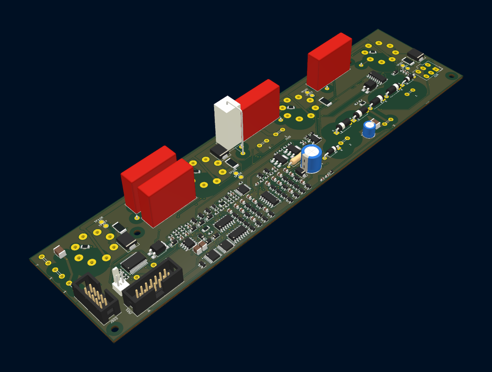

# Board renders

Rendered by CI from `johonkanen/tube_power_amp_kicad` commit [`66774174bd`](https://github.com/johonkanen/tube_power_amp_kicad/commit/66774174bdc07fa05581503c15b5ecf16376c193) on 2026-11-25 20:45 UTC with 10.0.7.
This branch is force-pushed on every render; do not commit to it.

## tube_power_amp_revb (`rev_b/kicad/tube_power_amp_revb.kicad_pcb`)

Copper layers:
- [B_Cu](tube_power_amp_revb/B_Cu.png)
- [F_Cu](tube_power_amp_revb/F_Cu.png)
- [In1_Cu](tube_power_amp_revb/In1_Cu.png)
- [In2_Cu](tube_power_amp_revb/In2_Cu.png)
