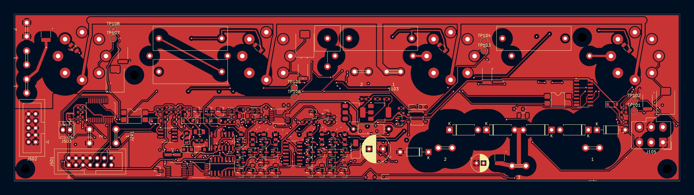
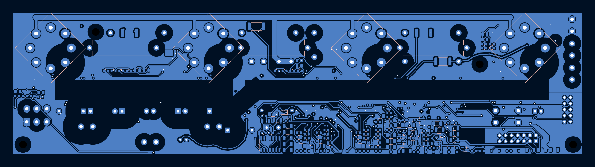
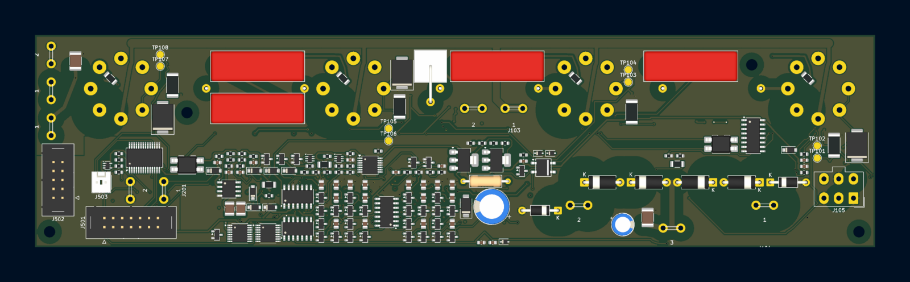
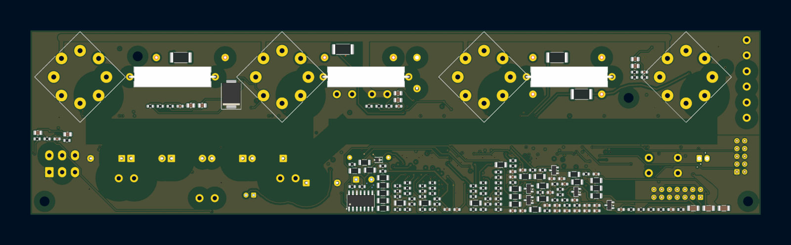

# tube_power_amp_kicad

KiCad 10 migration of the 4x EL34 power amp board (`OUTPUT`) of the tube amplifier, from Proteus. The schematic is redrawn from
the Proteus PDF and the PCB is rebuilt from the Gerber X2 export, so that every pad, track,
via and pour carries a net from the new schematic. The IPC-D-356A netlist of the CADCAM export
is the reference that every check compares against.

This is **rev A, the as-built baseline**. The redesign (ribbon cables, PCB-mount pots, the new
power section) starts from it. The amplifier project, its specification and the hardware state
are in [tube_amplifier_kicad](https://github.com/johonkanen/tube_amplifier_kicad), which includes
this repo as a submodule once the conversion is verified.

## Latest renders

Rendered by CI (`.github/workflows/renders.yml`) on every push to main that changes a `.kicad_pcb`. Every copper layer, an isometric 3D view and the commit the images were made from are on the [`renders` branch](https://github.com/johonkanen/tube_power_amp_kicad/tree/renders) (force-pushed by CI, never merged).






## Method

The shared [proteus2kicad](https://github.com/johonkanen/proteus2kicad) tools, a submodule in
`tools/p2k` (clone with `git clone --recurse-submodules`, or run `git submodule update --init`).
The phases and checks are in `tools/p2k/CONVERSION_PLAYBOOK.md`. Everything specific to this
board is in `p2k_config.py`.

## Status

Conversion plan: [PLAN.md](PLAN.md); progress: [STATUS.md](STATUS.md); prompt for the next agent session: [next_prompt.md](next_prompt.md).

Phase 0 (skeleton and inventory) done: `p2k_config.py` complete, `reference/` cheat sheets
generated from the IPC netlist, `tools/check_all.sh` passes. Phase 1 preparation done: part map,
symbol library, KiCad project skeleton (3 empty sheets), ERC and netlist comparison in
`check_all.sh`. Phase 1 (schematic) done: the 3 sheets are
transcribed (72/72 parts, netlist identical to the IPC netlist, ERC clean). Phase 2 (footprints)
done: every part fits the IPC pads (worst 0.001 mm), pin order checked (octal socket numbering is
mirrored against the standard: the sockets are on the bottom side, confirmed by the user, STATUS.md Findings 10). Phase 3 (PCB)
done: `kicad/tube_power_amp.kicad_pcb` was generated by `tools/make_pcb.sh` (now `tools/generate/`, frozen) from the schematic and the
Proteus gerbers (254 tracks, 4 plated mounting holes; reproducible byte for byte), copper 0 shorts /
0 orphans / 0 opens, DRC 0 shorts / 0 unconnected / 0 parity with the KiCad pad sizes. Phase 4
(independent verification) done: KiCad's IPC-D-356 export matches the Proteus netlist (146/146
records, 43 nets 1:1) and KiCad's gerbers match the Proteus gerbers (no unexplained copper
difference, 2010 Excellon 146/146); the C1-C6 KiCad 1.0 mm drills (Proteus 1.143 mm) are accepted by
the user. Phase 5 (clean-up, user decisions) done: the octal sockets U6-U9 are on the bottom side
(standard octal numbering, copper unchanged) and the references are placed clear of pads / silk /
edge (`p2k place_refdes`). `tools/check_all.sh`: ALL CHECKS PASSED. The conversion is complete; the
board was generated until 2026-11-20 (see below).
Open: the `VS'` terminal question (STATUS.md Findings 1).

Shared-tool migration (2026-11-20, p2k a9a286c): the board-local tools are replaced by the shared
proteus2kicad tools and `p2k_config.py` keys (part map, ERC, pin order, Phase 4 checks, `p2k make_pcb`,
the 2010 inch Excellon file read directly); every generated file is unchanged except two accepted
report-text lines (STATUS.md "Shared-tool migration 2026-11-20").

**Generation stopped 2026-11-20** (user decision; last generated state commit 785d209): the
committed KiCad files are the source now and the starting point for the redesign. The generators
are frozen history in `tools/generate/` and refuse to run (they would overwrite KiCad edits).

## Working on the board

1. Edit `kicad/tube_power_amp.kicad_pro` (schematic, PCB) and `lib/` in KiCad 10.
2. Run `tools/check_all.sh`. It checks the committed files against the Proteus truth (IPC netlist,
   gerbers, 2010 Excellon) and KiCad's rules: symbols, ERC, netlist vs IPC, footprint fit, pin
   order, board pads / holes, copper connectivity, DRC with parity, IPC-D-356 and gerber round trip.
3. A change that keeps copper and nets equal to Proteus passes. A deliberate deviation from the
   original (the redesign) makes a check fail: record it in `p2k_config.py` (`PENDING` / accepted
   items, with a reason) and in STATUS.md, never by removing the check.

Built in about 2010. The export in `source/cadcam/` matches the June 2010 fab Gerbers (`source/fab_2010/`) exactly: every hole and track.

## Source

OUTPUT.DSN/.LYT (Proteus 7, 2010), opened and saved in Proteus 8.12 as `OUTPUT.pdsprj`. Exported 2026-11-19 from Proteus 8.12 SP2: schematic PDF, Gerber X2 CADCAM (metric)
with the IPC-D-356A netlist.

## Mechanical baseline

From the export (the fit reference for the redesign; the KiCad file is
`mechanical/power_amp_OUTPUT.kicad_pcb` in tube_amplifier_kicad):

```
outline: 238.76 x 60.32 mm, lower-left corner at (-104.140, -25.400) in the Proteus frame
copper layers: 2; components: 72 (71 IPC refdes: BIASPOTX/BIASPOTO share BIASPO); mounting holes: 4
mounting holes (relative to the lower-left outline corner, mm):
  H1: x  234.140  y    4.400  drill 3.00 plated
  H2: x  234.140  y   55.400  drill 3.00 plated
  H3: x    4.140  y    4.400  drill 3.00 plated
  H4: x    4.140  y   55.400  drill 3.00 plated
```

## Layout

```
source/         Proteus exports (read-only)
  cadcam/         Gerber X2 export with the IPC-D-356A netlist (the reference)
  schematic_pdf/  schematic PDF to redraw from
  *.pdsprj        Proteus project (schematic values, devices, packages, pin names)
  fab_2010/       the RS-274X Gerbers the boards were made from (June 2010)
reference/      tables derived from the IPC netlist (p2k ipc356; generated, don't edit)
lib/            part map, symbol and footprint libraries (source since 2026-11-20, edit in KiCad)
kicad/          KiCad project (source since 2026-11-20, edit in KiCad)
tools/          check_all.sh runs every verification step
  generate/       frozen generators (history; do not run, see its README)
tools/p2k/       proteus2kicad (submodule)
p2k_config.py   board configuration for the tools
```
